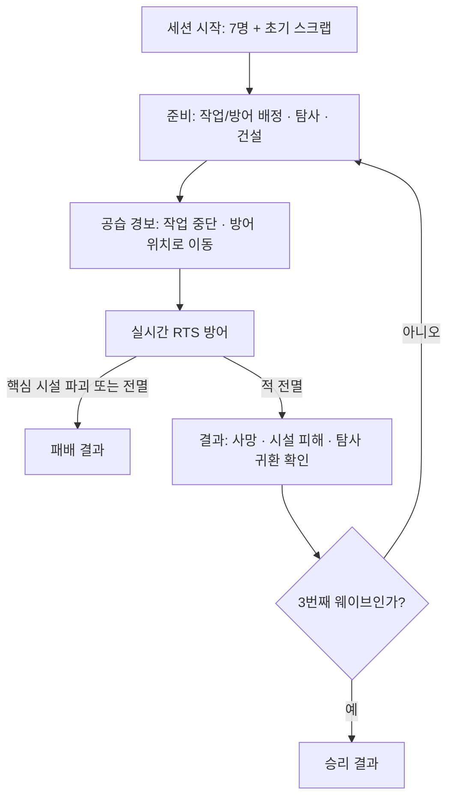

# ZDeffencePlan / PZDeffencePlan — Unity 재미 검증 POC 기준서

> **문서 상태:** POC 개발의 단일 기준(SSOT) · v1.0 · 2026-11-06  
> **적용 대상:** 두 기획 저장소를 참고해 제작하는 신규 Unity POC  
> **목적:** 게임의 재미를 검증하는 최소한의 플레이 가능한 실험. MVP, 알파, 제품화, 세계관 구현이 아니다.

## 0. 컨텍스트 압축 시 반드시 남길 핵심 (READ FIRST / NEVER DROP)

이 절은 대화 요약, 에이전트 핸드오프, 컨텍스트 압축 뒤에도 **원문 의미를 보존**해야 한다.

1. **한 줄 정의:** 한정된 인력을 **생산·탐사·방어**에 배분하고 **영구적인 인명 손실**을 감수하며 거점을 지키는 **쿼터뷰 생존 RTS**.
2. **핵심 검증 가설:** 인력 운용의 선택이 방어 결과를 바꾸고, 방어의 손실이 다음 인력 운용을 바꾸는 순환이 재미있는가?
3. **3대 불변 가치:** (A) 같은 인력을 생산·탐사·방어가 경쟁적으로 사용, (B) 능력과 역할이 서로 다른 개별 인력의 **영구 사망**, (C) 준비한 배치·건설의 결과가 **실시간 RTS 방어전**에서 나타남.
4. **선택 제공 방식:** 증강/카드/3지선다 보상 선택 화면이 **아니다**. 맵에서 작업·방어 구역을 지정하고, 탐사대를 파견하고, 방어 시설을 배치하며 발생하는 **내재적 선택**이다. 탐사 화면은 목적지·인원 지정 UI에 한정.
5. **폐교는 필수가 아니다.** 3D 프리미티브의 일반적인 거점으로 구현. 세계관·차원 균열·가챠·스토리·아트 완성도는 검증 대상이 아님. 단, **공간적 병목과 최소 두 진입 경로**는 남긴다.
6. **기본 실험 크기:** 맵 1개, 초기 생존자 7명, 능력치 3종(전투/작업/탐사), 스크랩 1종, 시설 유형 2종(방벽/감시탑) + 기본 생산 시설 1개, 탐사 지역 2곳, 적 2종, 웨이브 3회, 1회 10~15분 목표. 수치는 밸런스 조정 가능하나 시스템 종류를 늘려 해결하지 않는다.
7. **반드시 연결된 루프:** 준비(생산·파견·건설·배치) → 경보(작업 중단·방어 위치 자동 이동) → 실시간 방어 → 사망/시설 피해/자원 결과 반영 → 다음 준비. **탐사 중인 인력은 거점에 없어서 전투에 참여할 수 없다.**
8. **이중 배정:** 각 생존자는 평시 **작업 배정**과 전시 **방어 위치**를 각각 갖는다. 경보 시 생존자는 자신의 방어 위치로 자동 전환한다. 플레이어의 전투 중 직접 명령도 가능하다.
9. **명시적 비목표:** 서사, 학교 맵, 상세 생존 시뮬레이션, 가챠, 레벨업/스킬, 장비/인벤토리, 탐사 별도 전투 맵, 전투 액션 조작, 온라인, 세이브/로드, 고급 AI, 복잡한 생산 체인, 아트 폴리싱.
10. **판정 우선:** 기능 목록을 채운 것보다 플레이어가 배치·파견·건설의 상충을 인지하고 전략을 바꾸는지가 우선이다. 실패하면 콘텐츠 확장이 아니라 **상호작용/정보 전달/밸런스**를 수정한다.
11. **문서 우선순위:** 사용자 최신 명시 지시 > 본 문서의 '불변 원칙' > 본 문서의 확정 POC 결정 > 구현 파라미터 > 원본 저장소 기획. **원본 Unreal 기반 구현 지시를 그대로 이식하지 않는다.**
12. **변경 통제:** 불변 원칙을 건드리는 변경은 에이전트가 임의로 결정하지 않는다. 발견한 충돌·대체안을 보고하고 결정 기록을 남긴다. 세부 수치와 기술적 구현은 목적을 지키는 범위에서 자율 조정 가능하다.

---

## 1. 검증할 경험과 MDA 연결

### 핵심 경험

- **부족함 때문에 고민한다:** 좋은 전투원을 탐사에 보내면 거점 방어가 약해진다. 숙련 작업자를 방어 대기로 돌리면 시설과 자원 준비가 느려진다.
- **내 계획의 결과가 눈에 보인다:** 어느 진입로에 방벽을 놓고 누구를 감시탑에 배치했는지가 피해와 생존 여부를 바꾼다.
- **결과가 누적된다:** 유능한 인력이 죽으면 이후 선택지가 줄어들고 배치를 다시 설계해야 한다. 사망은 다음 웨이브까지 유지한다.

| Mechanics (규칙) | Dynamics (플레이 과정의 행동) | Aesthetics (느낌) |
| --- | --- | --- |
| 인력별 다른 능력, 제한된 7명, 임무의 상호 배타성 | 생산·탐사·방어 사이의 기회비용 계산 | **Challenge** |
| 이중 배정, 시설 위치, RTS 명령 | 예측·사전 준비·돌파 시 긴급 대응 | **Challenge / Expression** |
| 인력 영구 사망, 다음 라운드로 상태 이월 | 위험 회피, 핵심 인력 보호, 운영 재편 | **Narrative / Challenge** |

**테마/비주얼 판정은 범위 밖.** 폐교를 일반 거점으로 바꿔도 위 표의 인과 관계가 유지돼야 한다.

### 최소 성공 질문

1. 플레이어가 지시받지 않아도 **누구를 어디에 투입할지** 고민하는가?
2. 배치·건설을 다르게 하면 **방어 결과가 실제로 달라지는가?**
3. 누군가 죽은 이후 다음 준비에서 **인력 배분 또는 탐사 전략을 바꾸는가?**
4. 같은 조건에서 **다른 전략으로 다시 플레이할 의사**가 있는가?

---

## 2. 불변 원칙과 설계 경계

### 불변 — 삭제하거나 왜곡하지 말 것

| ID | 원칙 | 확인해야 하는 실제 플레이 |
| --- | --- | --- |
| INV-01 | 생산, 탐사, 방어는 **하나의 인력 풀**을 공유 | 파견 시 생산 또는 방어 능력이 감소한다 |
| INV-02 | 각 생존자는 **능력치 차이와 영구적인 개체 정체성**을 가짐 | 같은 작업에 사람을 바꾸면 결과가 달라지고, 죽은 인력은 복귀하지 않는다 |
| INV-03 | 각 생존자는 **평시 작업 배정 + 방어 배정**을 갖는다 | 경보가 울리면 미파견 인력이 자동으로 예정된 위치로 이동한다 |
| INV-04 | 건설/배치가 전투의 **경로, 사거리, 집중 화력**에 관여한다 | 전략적으로 다른 배치에서 피해 결과가 달라진다 |
| INV-05 | RTS의 **직접 선택·이동·공격 명령**은 가능하다 | 돌파 상황에 대응할 수 있지만 사전 운영을 완전히 무력화하지 않는다 |
| INV-06 | 탐사 결과와 전투 손실은 다음 주기로 **지속 반영**된다 | 남은 인력·시설·자원에 따라 다음 준비가 달라진다 |
| INV-07 | 모든 주요 선택은 **공간·명령·배정·파견**에서 발생 | 랜덤 강화 카드나 장르 외적인 3지선다 선택창으로 대체하지 않는다 |
| INV-08 | 본 POC는 **단일 짧은 세션에서 반복 가능하고 관찰 가능**하다 | 시드 고정·간단 로그·즉시 재시작 가능 |

### 변경 가능 — POC 테스트를 위한 조정 값

준비/전투 시간, 생산 속도, 시설 비용·체력·사거리, 적 체력·속도·수량, 탐사 소요 시간·보상·손실 확률, 인력 능력치의 구체 값, HUD 배치는 테스트를 통해 바꿀 수 있다. **범위 확대와 불변 원칙 변경은 수치 조정으로 취급하지 않는다.**

---

## 3. 확정 범위 및 규칙 (구현 결정)

| 항목 | 확정 POC 정의 | 제외 / 경계 |
| --- | --- | --- |
| 엔진 | **Unity 6, URP, C#**, PC, 싱글플레이 | Unreal 지시, 멀티플레이 |
| 시점 | 3D 쿼터뷰, 팬/줌, 고정 경사각 | 360도 카메라 회전은 후순위 |
| 조작 | 좌클릭 단일 선택, 드래그 다중 선택, Shift 선택 추가, 우클릭 바닥=이동/적=공격, 건설 및 배정 UI | 명령 대기열·컨트롤 그룹·액션 모드 불필요 |
| 맵 | 프리미티브 기반 소형 거점 1개, 두 공격 접근로, 한 개 핵심 시설, 막을 수 있는 좁은 구간 | 폐교 아트, 탐사 별도 맵, 절차 생성 |
| 인력 | 이름과 고유 ID가 있는 **초기 7명**, 전투·작업·탐사 능력(각 1~5), HP, 작업 배정, 방어 위치, 파견 상태 | 추가 고용·소환·특성·8종 이상 스탯·장비 |
| 작업 | 기본 생산 시설 **1개(미리 배치)**, 작업자 최대 2명, 평시만 스크랩 생산 | 생산 시설 종류 확장, 운반·인벤토리 |
| 자원 | 스크랩 **1종**, 시설 설치/수리 비용 및 탐사 보상 | 식량·물·전력·연료·탄약 경제 |
| 건설 | **방벽, 감시탑** 두 유형. 준비 시간에 위치를 지정해 즉시 배치; 건설 비용 소모 | 건설 시간/대기열/연구/업그레이드 |
| 방어시설 | 방벽은 경로를 막고 공격받음. 감시탑은 생존자 배정 시 사거리/화력 보너스; **감시탑 자체는 독립 자동 사격하지 않음** | 별도 터렛 AI·전력·탄약 생산 |
| 탐사 | **근거리/원거리 2곳**, 인원 1~3명으로 오프맵 파견, 시간 경과 후 귀환·자원·사망 결과 | 원본 '최소 4명' 규칙은 POC에서 의도적으로 완화. 이벤트 선택지/전투 맵 없음 |
| 전투 | 적 **기본형/돌파형 2종**, 자동 탐지·사격, 바리케이드 공격, 실시간 직접 명령 | 보스/상태이상/복잡한 전술 AI |
| 라운드 | 준비 → 경보 → 전투 → 결과의 **3웨이브** | 무한 모드, 장기 생존일수 |
| 패배·성공 | 핵심 시설 HP 0 또는 전멸 = 즉시 패배; 세 번째 웨이브 방어 성공 = 승리 | 다중 엔딩 |
| 세션 | **10~15분 목표**, 리스타트 가능, 시작 구성/난수 시드 선택 가능 | 세이브/로드, 진행도 보존 |

### 세부 동작 규칙

#### 3.1 인력 상태와 작업/방어 이중 배정

- 인력은 개별 ID, 이름, HP, `Combat / Work / Exploration`, 생존 여부, 현재 임무를 가진다. 초기 7명은 고정 조합이며 능력치에 충분한 차이를 둔다(전투 특화/작업 특화/탐사 특화/범용 인력).
- **작업 배정**은 기본 생산 시설 또는 **방어 대기** 중 하나, **방어 배정**은 맵의 지점 또는 감시탑 자리로 지정한다. 두 배정은 별도로 유지하며 한쪽을 바꿔도 다른 쪽이 초기화되지 않는다. **방어 대기** 인력은 평시부터 지정된 방어 위치를 지키며 생산하지 않는다.
- 평시 생산 담당은 생산 시설에서 일하고 방어 대기 인력은 방어 위치에 머문다. 경보가 발생하면 **파견 중이지 않은** 인력의 작업을 중단하고 방어 배정 위치로 **실제 이동**한다(순간이동 금지). 생산 시설이 방어선과 떨어져 있고 경보 시간이 짧아서, 끝까지 생산한 인력은 **초기 교전에 늦을 수 있다**. 전투 종료 후 살아남은 인력은 기존 작업 배정으로 복귀한다.
- 전투 중 직접 명령은 방어 배정을 **일시적으로 덮어쓰는** 행동으로 취급한다. 다음 경보에서는 저장된 방어 배정을 다시 사용한다.
- 탐사 중인 인력은 월드/작업/방어에서 제거되는 것이 아니라 **일시 이탈 상태**로 표시되며, 복귀 전까지 어떠한 거점 행동도 할 수 없다.
- HP가 0인 생존자는 즉시 영구 사망 처리하며 이후 선택·배정·탐사·전투에서 제외한다. 생존 인원의 HP는 웨이브 결과 단계에서 **전량 자동 회복**시켜 복잡한 치료 시스템 없이 사망의 영구성만 실험한다. 이는 POC 전용 의도적 단순화다.

#### 3.2 생산과 자원

- 기본 생산 시설은 미리 배치되며 신규 건설하지 않는다. 작업 배정 인원 최대 2명. 생산량은 작업 능력과 근무 시간에 따라 증가한다.
- **경보/전투 중 생산 중단**. 탐사에 보낸 작업자는 생산량에서 빠진다. 방어 대기를 선택한 인력도 생산량에 기여하지 않으므로 **미리 방어선에 대기시킬지, 경보까지 일하게 할지**가 실제 선택이 된다.
- 스크랩은 방벽·감시탑 설치와 파손 시설 수리/재설치에 쓰인다. 탐사로도 얻는다.
- 시작 스크랩은 제한되어 **초기 방어시설을 모두 지을 수 없어야 한다.** 건물 위치와 탐사/생산의 선택이 필요하다.

#### 3.3 탐사

- 탐사는 준비 단계에만 시작할 수 있고, 파견 후 시간이 실제로 흐른다. 자동 귀환 전까지 다른 명령 불가. **전투가 시작되더라도 파견은 지속**한다.
- 근거리는 짧고 낮은 위험/낮은 보상, 원거리는 길고 높은 위험/높은 보상. 인원수와 탐사 능력이 보상 및 생존률에 영향을 준다.
- 결과는 `보상 획득`, `빈손 귀환`, `귀환 중 최대 1명 사망`의 단순한 결과로 제한한다. 사망한 인력은 영구 제거된다.
- 전투 중 귀환한 살아 있는 인력은 안전한 복귀 지점에서 등장해 자신에게 저장된 방어 배정 위치로 이동한다. 귀환·손실·획득 자원을 명확하게 알린다.
- 예상 복귀 시간과 지역별 상대적인 위험·보상은 UI에 표시한다. **결과 선택 카드/증강 UI는 구현하지 않는다.**

#### 3.4 건설과 지형

- 방벽은 이동을 차단하고 HP를 가지며, 적의 길이 막히면 적이 방벽을 공격할 수 있다. **경로 재탐색/우회 또는 벽 타격**이 정상적으로 작동해야 한다. 벽 관통은 버그로 본다.
- 감시탑은 배정된 인력이 사용하면 일반 지상보다 명중/사거리 또는 공격력의 이득이 발생한다. 탑 자체는 별도 자동 화력을 내지 않는다.
- 설치 후보지는 맵에서 제한한다. 경로를 완전히 폐쇄하더라도 적이 방벽을 공격해 진입할 수 있도록 한다.
- 준비 단계에서 설치/수리만 가능. 전투 중 건설은 금지. 이로써 사전 계획이 의미를 갖도록 한다.

#### 3.5 전투와 패배

- 적 기본형은 핵심 시설을 목표로 이동하며 사거리 내 생존자와 방해 시설에 대응한다. 돌파형은 방벽에 효율적인 피해를 주어 방어선의 약점을 노출시킨다.
- 생존자는 방어 위치에서 자동 표적 탐지·공격하며 플레이어의 우클릭 공격/이동 명령이 우선한다. 명령 대상이 없어지면 일반 자동 방어로 돌아간다.
- 웨이브는 사전에 정의된 적 구성으로 시작한다. 전원 처치 시 승리 처리하며, 핵심 시설 파괴/전원 사망 시 즉시 패배한다. 적 이동 불능 등으로 진행이 멈추지 않도록 **전투 시간 상한과 실패 처리**를 둔다.
- 웨이브 종료 후 피해 시설은 유지되고, 살아남은 인력 수와 누적 스크랩이 다음 준비로 넘어간다. 사망자는 복구되지 않는다.

---

## 4. 테스트용 초기 밸런스 — 가변 파라미터

아래는 **실험을 시작하기 위한 초깃값**이며 불변 메커닉이 아니다. 동작을 확인한 후 테스트로 수정한다.

| 항목 | 제안 초기값 | 설계 의도 |
| --- | --- | --- |
| 시작 인력 | 7명(전투 특화 2, 작업 특화 2, 탐사 특화 1, 범용 2) | 능력치에 따른 배치 차이 |
| 시작 스크랩 | 8 | 방벽 2개 또는 감시탑 1개 수준 |
| 방벽 비용 | 4 | 다수의 간단한 방어선 선택 |
| 감시탑 비용 | 8 | 값비싼 화력 집중 선택 |
| 생산 | 작업 능력 3인 작업자 1명이 20~30초당 스크랩 약 1개, 최대 2명 근무 | 탐사 파견에 따른 생산 기회비용 |
| 준비 시간 | 웨이브당 100초 | 인력 편성·파견·건설·재배치 |
| 경보 준비 | 10초 | 실제 이동 시간을 통한 생산 지속 vs 방어 대기의 상충 |
| 전투 시간 상한 | 100초 | 막힌 전투의 무한 진행 방지 |
| 근거리 탐사 | 70초, 소규모 보상/낮은 사망 위험 | 빠른 자원 확보와 낮은 리스크 |
| 원거리 탐사 | 150초, 높은 보상/높은 사망 위험 | **웨이브와 파견이 겹칠 수 있음** |
| 원정 인원 | 1~3명 | 위험·보상과 병력 공백의 연속적 선택 |
| 웨이브 적 편성 | W1: 기본 5, 돌파 0 / W2: 기본 6, 돌파 2 / W3: 기본 8, 돌파 3 | 두 경로 방어를 단계적으로 학습 |

**수치 검증 조건:** (1) 탐사를 아예 안 보내는 전략이 항상 최선이면 실패, (2) 늘 최대로 파견하는 전략이 항상 최선이어도 실패, (3) 방어 시설 위치를 바꿔도 결과가 같다면 실패. 최소한 둘 이상의 전략이 각자의 강점과 약점을 보여야 한다.

## 5. 필수 플레이 플로우 및 화면

### 5.1 상태 흐름



- 준비 중 탐사는 시작할 수 있으며, **진행 중 탐사는 경보·전투를 가로질러 계속 진행한다.**
- 1회 세션의 목표 길이는 10~15분이며 결과 화면에서 즉시 같은 초기 조건으로 다시 시작할 수 있다.

### 5.2 필수 UI (메인 3D 월드 중심)

1. **상단 HUD:** 웨이브/카운트다운, 스크랩, 핵심 시설 HP, 생존자 수.
2. **생존자 목록:** 이름, HP, `작업/경비/탐사/사망` 상태, 선택 강조. 죽거나 파견된 인력은 구분.
3. **선택 패널:** 능력치 3개, 현재 작업 배정, 방어 위치 지정, 현재 행동/명령.
4. **건설 패널:** 방벽/감시탑 선택, 비용, 설치 미리보기, 불가 위치 표시, 수리.
5. **탐사 패널:** 근/원거리, 인원 1~3명 선택, 예상 복귀 시간, 상대 위험·보상, 파견/진행/결과.
6. **경보·결과 피드백:** 경보 시 방어 위치로 이동하는 모습, 탐사 귀환, 사망 알림, 웨이브 피해·자원·인력 결과, 다시 시작.

UI는 POC 수행에 필요한 정보를 숨기지 않는다. 보기에 복잡한 아트보다 **기회비용과 결과의 가시성**이 우선이다. 별도 인벤토리, 연구, 소환, 상세 통계 화면은 없다.

## 6. Unity 구현 가이드 (규칙은 고정, 구조는 최소화)

- **기본 스택:** Unity 6, URP, C#, Input System, AI Navigation/NavMeshAgent, UGUI. 프리미티브/임시 머티리얼 사용. Unity 프로젝트 기존 버전이 있다면 충돌 없이 해당 프로젝트 설정 우선.
- **단일 씬:** `POC_Main` (거점·카메라·유닛·스폰 지점·HUD). 별도 탐사 씬 제작 금지.
- **최소 책임 분리:** `GameSession`(상태/승패), `Survivor`(체력/스탯/상태), `Assignment`(작업·방어 이중 배정), `ResourceEconomy`(스크랩/생산/비용), `Expedition`(파견/귀환/결과), `Building`(방벽/탑), `WaveDirector`(웨이브), `RTSInput`(선택/명령). 이름은 구현 상황에 맞게 달라도 기능 경계는 유지.
- **데이터:** 게임 규칙·초기 인력·웨이브 구성·시설값은 ScriptableObject 또는 직렬화된 설정으로 분리하여 코드 변경 없이 밸런스 튜닝 가능하게 한다. 대규모 범용 프레임워크나 데이터 파이프라인은 만들지 않는다.
- **테스트 재현:** 세션 시작 시 RNG 시드를 기록하고 초기 상태를 동일하게 재설정 가능. 적 스폰·탐사 결과 등 난수는 명시된 시드 기반. 물리·AI 차이로 결과가 완벽히 같지 않을 수 있음은 로그에 표시.
- **상태 일관성:** 사망자 재배정 금지, 파견 중 중복 배정 금지, 자원 음수 금지, 시설 중복 점유 금지, 경보 후 작업 생산 지속 금지.
- **디버그 우선:** 상태 단계 강제 진행, 자원 지급, 웨이브 재시작 등 테스트 버튼은 디버그 전용으로 허용하되 정규 플레이 UI를 대체하지 않는다.

## 7. 테스트 / 통과 기준

### 구현 수락 조건 (전부 만족해야 POC 완료)

- [ ] 같은 7명을 생산·탐사·방어가 경쟁적으로 사용하며 인력 이탈이 화면/수치에 반영된다.
- [ ] 작업 배정과 방어 배정이 독립적으로 저장되고, 경보에서 실제 이동으로 자동 전환된다. **생산을 끝까지 지속한 인력과 미리 방어 대기한 인력의 초기 대응 차이**가 나타난다.
- [ ] 인력 7명에 단일/다중 선택과 이동/공격 명령이 작동한다.
- [ ] 방벽과 감시탑을 어디에 놓는지에 따라 적 동선/사거리/방어 결과가 달라진다.
- [ ] 파견 중 인력은 방어할 수 없고, 파견은 전투 중에도 계속 진행되며 결과가 적용된다.
- [ ] 사망한 인력은 해당 세션에서 영구 제거되어 다음 웨이브의 선택/작업/방어에 없다.
- [ ] 3웨이브 진행, 성공·실패 및 결과, 같은 조건 재시작이 완결된다.
- [ ] 원본 세계관·가챠·별도 탐사 맵·액션 직접 조작을 구현하지 않아도 전체 루프가 성립한다.

### 재미 검증 (최소 5명 플레이테스트 권장; 탐색적 기준)

| 검증 가설 | 관찰/기록 | 잠정 성공 신호 |
| --- | --- | --- |
| 인력 배분이 고민을 만든다 | 파견 전/후 배치 변경, 포기한 역할, 발화 | 5명 중 4명 이상이 상충을 자발적으로 언급 또는 전략 변경 |
| 사전 배치가 전투를 바꾼다 | 동일 시드에서 시설/인력 배치 변경 후 코어 HP·사망자 비교 | 결과 차이가 반복적으로 관찰됨 |
| 영구 손실이 다음 운영을 바꾼다 | 사망 직후 다음 준비의 배정·파견 변경 | 사망을 겪은 플레이어 다수가 대체 계획을 수립 |
| 재도전할 이유가 있다 | 같은 조건 재플레이 의향과 변경하고 싶은 전략 | 다른 전략을 구체적으로 말할 수 있음 |

숫자는 통계적 유의성을 의미하지 않으며 **게임 디자인 판단을 위한 초기 통과선**이다. 실패 시 먼저 난이도·피드백·선택의 효과가 보이는지 점검한다. 기능 추가로 실패를 덮지 않는다.

### 최소 기록할 이벤트

`SessionStart(seed)`, `AssignmentChanged(unit, work, defense)`, `ExpeditionStarted(region, party)`, `ExpeditionResolved(reward, casualties)`, `BuildingPlaced(type, position, cost)`, `WaveStarted(index)`, `SurvivorDied(id, cause)`, `WaveEnded(index, coreHP, alive, scrap)`, `SessionEnded(result)`.

JSONL 또는 CSV 중 간단한 형식 하나면 충분하다. 분석용 외부 서비스는 불필요하다.

## 8. 에이전트 운영, 결정 기록 및 컨텍스트 복구

### 착수 순서

1. 이 문서의 **0절과 2절**을 읽어 불변 원칙을 확인한다.
2. 현재 Unity 프로젝트 구조/버전/기존 씬·스크립트를 조사한다. UE 기획 자료는 **도메인 참고**로만 사용한다.
3. 가장 위험한 관계인 **이중 배정 → 경보 자동 전환 → 직접 RTS 전투 → 사망 이월**을 먼저 수직 슬라이스로 연결한다.
4. 다음으로 생산·건설·탐사를 접합한 3웨이브 완결 루프를 만든다.
5. 같은 시드로 플레이하여 배치의 영향과 인력 손실의 영향을 확인한다. 결과 없이 '재미 검증 완료'라 하지 않는다.

### 컨텍스트 압축 후 복구 프로토콜

새 세션/워커가 이어받거나 컨텍스트가 압축되었다면, **이 문서의 0절을 먼저 재독**한다. 그 후 2·3·7절과 아래 결정 기록을 확인하고, 실제 Unity 프로젝트 상태와 대조한다. 기존 구현이 이 문서와 충돌하면 임의로 사양을 바꾸지 말고 충돌을 드러낸다.

### 결정 기록 (DECISIONS)

| ID | 확정 결정 | 근거 / 의도 |
| --- | --- | --- |
| DEC-01 | 폐교·세계관은 POC 필수가 아님 | 공간의 상충과 인력 운용만 검증 |
| DEC-02 | Unity 6 기반 RTS, 액션 모드 제외 | 게임 장르·핵심 조작 검증에 집중 |
| DEC-03 | 고정 7명, 사망 시 신규 충원 없음 | 인력 손실의 인과 관계를 명확히 관찰 |
| DEC-04 | 능력치 3종으로 축소 | 역할 간 차이만 필요 |
| DEC-05 | 생산 1개(기본 설치), 방벽/감시탑 건설 2종 | 최소한의 자원 대 방어 선택 |
| DEC-06 | 작업/방어 이중 배정 + 경보 자동 전환 | PZ 설계의 차별화 메커닉 유지 |
| DEC-07 | 탐사 1~3명, 근/원거리 2곳, 별도 맵 없음 | 원본 최소 4명 제한은 작은 POC의 선택 폭을 좁혀 의도적으로 완화 |
| DEC-08 | 탐사와 웨이브는 시간상 겹칠 수 있음 | 파견의 기회비용이 실제 방어력과 연결돼야 함 |
| DEC-09 | 생존자 HP는 웨이브 결과 단계에서 완전 회복 | 치료/부상 관리 제거하고 영구 사망만 검증 |
| DEC-10 | 세션은 3웨이브, 10~15분, 고정 시드 지원 | 비교 가능한 짧은 실험 |
| DEC-11 | 의사결정은 작업/배치/파견/명령에서 발생 | 카드/증강 선택 방식으로 오해 방지 |
| DEC-12 | 시설·인력 수·시스템 종류 추가보다 먼저 밸런스/피드백 수정 | POC 범위 유지 |

### 신규 결정·변경 로그 양식

새로운 설계 충돌이나 변경이 발생할 경우 이 절 뒤에 다음 항목을 추가한다.

```text
[YYYY-MM-DD] [DEC-XX / CHANGE-XX]
- 문제/필요성:
- 변경하려는 내용:
- 불변 원칙 영향: 있음/없음 (관련 INV-ID)
- 핵심 경험 검증 영향:
- 결정: 승인/보류/기각 (승인 주체)
- 관련 구현/테스트:
```

착수 전 확정한 DEC-13 이후의 결정은 [`DECISIONS.md`](DECISIONS.md)에 있다.

```text
[2026-11-06] [CHANGE-01]
- 문제/필요성: 6절의 단일 씬 POC_Main과 프로젝트 작업 지침의 씬 순서가 충돌
- 변경하려는 내용: 빌드 씬을 Preload → Title → Game 순서로 구성. Game이 POC_Main의 역할을 맡고, 시드 선택은 Title, 재시작은 Game 재로드로 처리
- 불변 원칙 영향: 없음. 게임플레이는 한 씬이고 별도 탐사 씬도 만들지 않는다
- 핵심 경험 검증 영향: 없음. 재시작 즉시성(INV-08)은 Game 재로드로 유지
- 결정: 승인 (사용자)
- 관련 구현/테스트: Assets/Scenes, FlowTableData.json
```

```text
[2026-11-06] [CHANGE-02]
- 문제/필요성: 플레이에서 방어 위치 지정과 감시탑 입장이 직관적이지 않고, 3절의 "우클릭 바닥=이동"은 준비 단계에서 저장되지 않는 임시 이동이라 쓸모가 적음
- 변경하려는 내용: 준비 단계의 바닥 우클릭을 방어 위치 지정으로, 감시탑 우클릭을 입장 지시로 변경. 경보·전투의 이동·공격 명령은 유지
- 불변 원칙 영향: 없음. 이중 배정(INV-03)과 직접 명령(INV-05) 유지
- 핵심 경험 검증 영향: 배치 조작이 쉬워져 상충 판단에 집중. 사람 플레이로 미검증
- 결정: 사용자 피드백에 따른 에이전트 구현 판단, 사용자 확인 대기
- 관련 구현/테스트: RTSInput, GameSession, PlayFeedbackTests. DECISIONS.md DEC-32, DEC-33
```

### 원본 기획 출처(참고 자료, 우선 규칙 아님)

- [PZDeffencePlan — 기획서 메인](https://github.com/Bo-sung/PZDeffencePlan/blob/master/기획서/기획서%20메인.md)
- [PZDeffencePlan — 인력](https://github.com/Bo-sung/PZDeffencePlan/blob/master/기획서/시스템/인력.md)
- [PZDeffencePlan — 방어](https://github.com/Bo-sung/PZDeffencePlan/blob/master/기획서/시스템/전투/방어.md)
- [ZDeffencePlan — 메인 기획](https://github.com/Bo-sung/ZDeffencePlan/blob/master/1.게임_기획/main_game_design.md)
- [ZDeffencePlan — 조작](https://github.com/Bo-sung/ZDeffencePlan/blob/master/1.게임_기획/시스템_상세/control_system.md)
- [ZDeffencePlan — 탐사](https://github.com/Bo-sung/ZDeffencePlan/blob/master/1.게임_기획/시스템_상세/exploration_system.md)

> **최종 판단 원칙:** 이 POC는 '폐교 생존 게임의 작은 버전'을 만드는 작업이 아니다. **인력 운용 → 방어 결과 → 돌이킬 수 없는 손실 → 재운용**이라는 경험이 재미있는지를 검증하는 최소 실험이다.
